# Free React, Tailwind CSS and React Native components by UpFork

Twenty-two free, MIT-licensed components from [UpFork](https://upfork.dev). Three are React components that you add
to a React + Tailwind project with the shadcn CLI, with no account, token or setup. Three are sections in a single
HTML file each, with no framework. Sixteen are React Native components for Expo apps, each a small app you can run. Every one
has a live preview on upfork.dev, in light and dark: the web ones at phone, tablet and desktop width, the mobile ones
in a phone you use with the mouse, or with your finger on your own phone.

| Component | What it is | Kind |
| --- | --- | --- |
| [Crowdwall](#crowdwall) | Community hero over an endless wall of portraits | React, shadcn CLI |
| [Border Beam Button](#border-beam-button) | Pill button with a comet of light running round its border | React, shadcn CLI |
| [Interactive SaaS Hero](#interactive-saas-hero) | Hero whose app window runs a working product demo | React, shadcn CLI |
| [Aurora Glass Testimonials](#aurora-glass-testimonials) | 3D stack of glass testimonial cards | HTML + Tailwind CSS |
| [Pulse Bento Feature Highlights](#pulse-bento-feature-highlights) | Feature cards that are small live demos | HTML + Tailwind CSS |
| [Spotlight Bento Feature Showcase](#spotlight-bento-feature-showcase) | Feature timeline linked to a bento grid of images | HTML + Tailwind CSS |
| [Fluid Tab Bar](#fluid-tab-bar) | Floating tab bar whose highlight stretches like liquid | React Native, Expo |
| [Swipe Deck](#swipe-deck) | Card stack to swipe left, right or up, with undo | React Native, Expo |
| [Goal Ring](#goal-ring) | Progress ring with a glow, drawn with Skia, set by dragging | React Native, Expo |
| [Slide to Confirm](#slide-to-confirm) | Slide-to-pay button with busy, done and error states | React Native, Expo |
| [Focus Scroll](#focus-scroll) | List where only the item on the focal line is sharp | React Native, Expo |
| [Gooey Tab Bar](#gooey-tab-bar) | Tab bar whose bubble flies between tabs on liquid necks | React Native, Expo |
| [Lustre Cards](#lustre-cards) | Payment cards in live metal that tilt, flip and freeze | React Native, Expo |
| [Choice Chips](#choice-chips) | Multi-select chips that fill from where you pressed | React Native, Expo |
| [Arc Picker](#arc-picker) | Curved dial of items, like a camera's filter dial | React Native, Expo |
| [Toast Stack](#toast-stack) | Stacked, swipeable toasts you call from anywhere | React Native, Expo |
| [Clockface](#clockface) | Time picker where a wheel and a live clock move as one | React Native, Expo |
| [Ambient Carousel](#ambient-carousel) | Cover flow with a glow in the front cover's colours | React Native, Expo |
| [Morph Text](#morph-text) | Letters that glide to their new places, numbers that roll | React Native, Expo |
| [Filmstrip](#filmstrip) | Photo viewer with a squeeze strip of thumbnails | React Native, Expo |
| [Depth Drawer](#depth-drawer) | Side menu the screen steps back from, in four styles | React Native, Expo |
| [Confirm Button](#confirm-button) | Two-step delete with a liquid cancel bubble, or hold to confirm | React Native, Expo |

## React components

Add one to your project with the shadcn CLI. It writes the component's files into your project, with its packages.

### Crowdwall

<a href="https://upfork.dev/products/crowdwall">
  <picture>
    <source media="(prefers-color-scheme: dark)" srcset=".github/previews/crowdwall-dark.webp">
    
  </picture>
</a>

A hero section for communities and social products: a badge, a headline and a call to action over an endless wall
of portraits whose rows slide in alternating directions. Pure CSS motion, light, dark or auto theme.

```bash
npx shadcn@latest add https://upfork.dev/r/crowdwall.json
```

[Live preview](https://upfork.dev/products/crowdwall) · [Source and docs](crowdwall)

### Border Beam Button

<a href="https://upfork.dev/products/border-beam-button">
  <picture>
    <source media="(prefers-color-scheme: dark)" srcset=".github/previews/border-beam-button-dark.webp">
    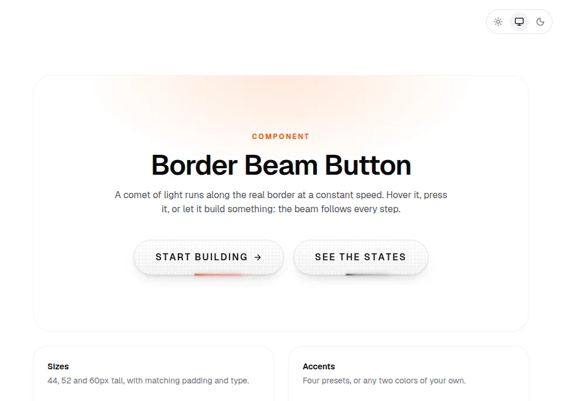
  </picture>
</a>

A pill call to action with a comet of light that travels round its border. Unlike the usual rotating conic
gradient, the beam moves at a constant speed along the real rounded border, reacts to the cursor, and walks
through loading, success and error by itself when its action is async.

```bash
npx shadcn@latest add https://upfork.dev/r/border-beam-button.json
```

[Live preview](https://upfork.dev/products/border-beam-button) · [Source and docs](border-beam-button)

### Interactive SaaS Hero

<a href="https://upfork.dev/products/interactive-saas-hero">
  <picture>
    <source media="(prefers-color-scheme: dark)" srcset=".github/previews/interactive-saas-hero-dark.webp">
    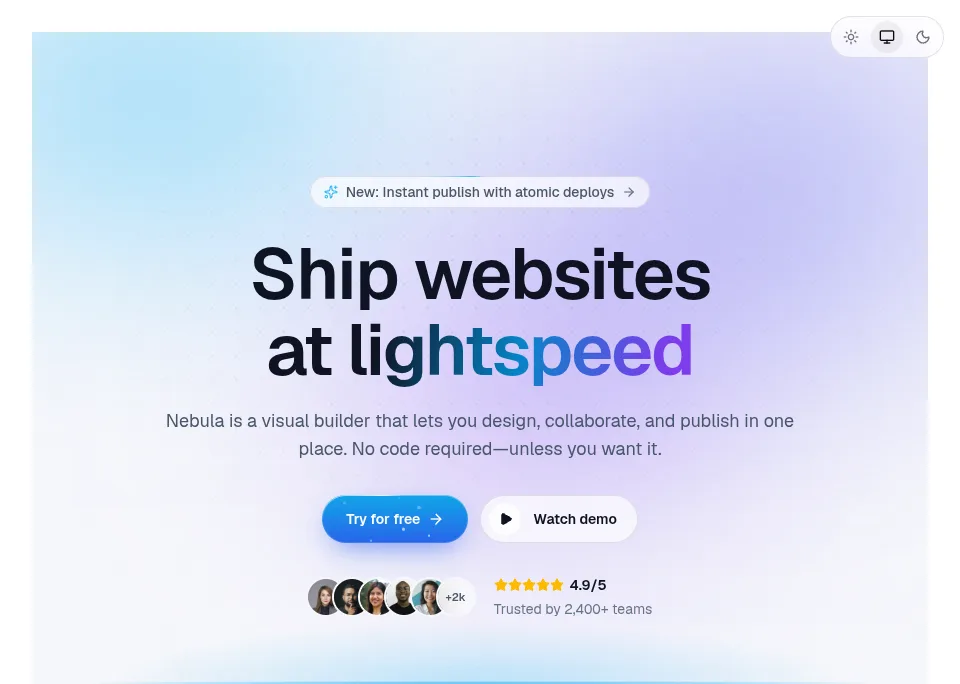
  </picture>
</a>

A hero for a SaaS product whose app window isn't a picture: it runs a small working demo that visitors can play
with, and that plays itself when left alone. Aurora background, animated calls to action, social proof.

```bash
npx shadcn@latest add https://upfork.dev/r/interactive-saas-hero.json
```

[Live preview](https://upfork.dev/products/interactive-saas-hero) · [Source and docs](interactive-saas-hero)

## HTML sections

Each is one HTML file with Tailwind CSS and a little vanilla JavaScript: no framework and no build step. Copy the
section into your page (each folder's README shows how), or open its `index.html` to try it.

### Aurora Glass Testimonials

<a href="https://upfork.dev/products/aurora-glass-3d-card">
  <picture>
    <source media="(prefers-color-scheme: dark)" srcset=".github/previews/aurora-glass-3d-card-dark.webp">
    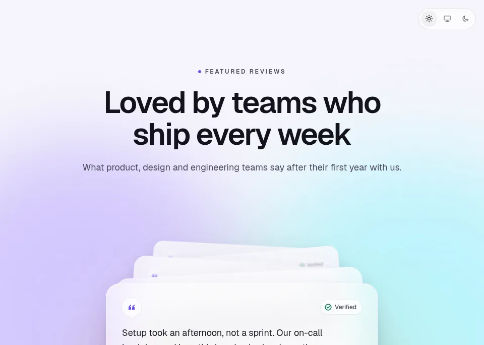
  </picture>
</a>

A 3D stack of glass testimonial cards over a drifting aurora. Drag or swipe the front card to the back, use the
buttons or the arrow keys, or let it play. Accessible, and it works without JavaScript.

[Live preview](https://upfork.dev/products/aurora-glass-3d-card) · [Source and docs](aurora-glass-testimonials)

### Pulse Bento Feature Highlights

<a href="https://upfork.dev/products/pulse-bento-feature-cards">
  <picture>
    <source media="(prefers-color-scheme: dark)" srcset=".github/previews/pulse-bento-feature-cards-dark.webp">
    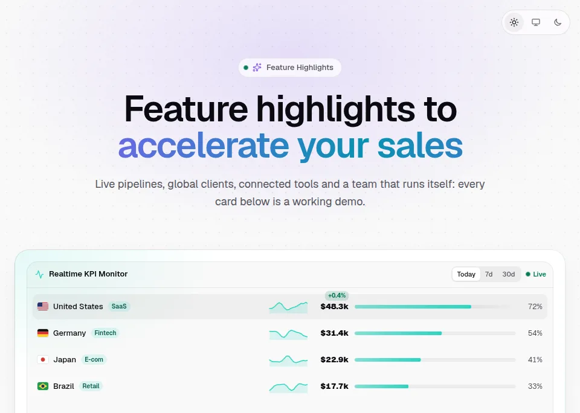
  </picture>
</a>

A SaaS feature section whose four cards are small working demos rather than pictures of them: revenue ticks,
clients scroll past a dotted globe, packets travel to a hub, and a team adds a member while you watch.

[Live preview](https://upfork.dev/products/pulse-bento-feature-cards) · [Source and docs](pulse-bento-feature-highlights)

### Spotlight Bento Feature Showcase

<a href="https://upfork.dev/products/spotlight-bento-grid-feature-section">
  <picture>
    <source media="(prefers-color-scheme: dark)" srcset=".github/previews/spotlight-bento-grid-feature-section-dark.webp">
    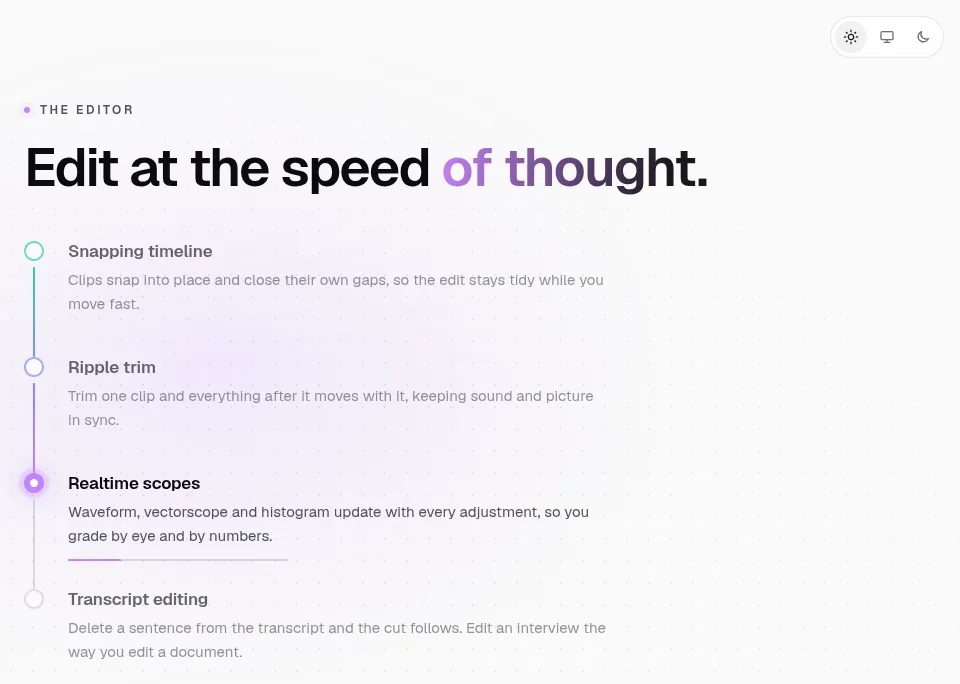
  </picture>
</a>

A feature section whose two columns talk to each other: a feature timeline on the left, a bento grid of images on
the right. Point at either, or let autoplay run, and that feature takes the spotlight on both sides.

[Live preview](https://upfork.dev/products/spotlight-bento-grid-feature-section) · [Source and docs](spotlight-bento-feature-showcase)

## React Native components

Each folder is a small Expo app (SDK 57) with the component and its demos: run it in your browser or in Expo Go on
your phone. To use a component in your own Expo app, copy its `components/` and `lib/` folders and install its
packages with the line below (its README has the rest). Built with Reanimated 4, Gesture Handler and Skia, in light and
dark, for a finger and for the mouse.

### Fluid Tab Bar

<a href="https://upfork.dev/products/fluid-tab-bar-react-native">
  <picture>
    <source media="(prefers-color-scheme: dark)" srcset=".github/previews/fluid-tab-bar-react-native-dark.webp">
    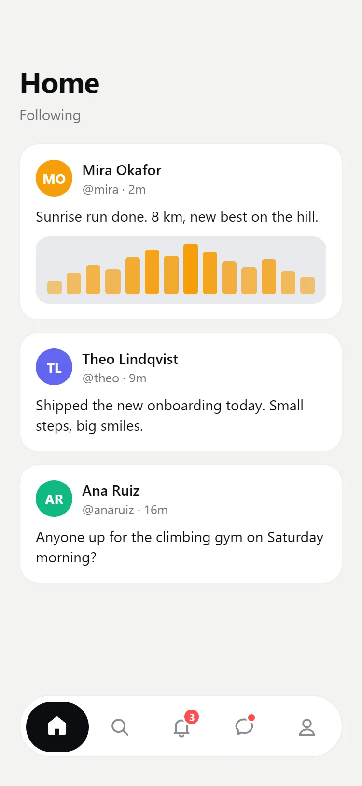
  </picture>
</a>

A floating bottom tab bar whose highlight moves like a drop of liquid: its leading edge darts to the tab you pick,
the other follows, and the pill stretches, thins and settles. Icons light up as it passes, badges pop, and in
`expand` the focused tab opens to show its label.

```bash
npx expo install react-native-reanimated react-native-worklets react-native-svg expo-haptics
```

[Live preview](https://upfork.dev/products/fluid-tab-bar-react-native) · [Source, demo app and docs](fluid-tab-bar)

### Swipe Deck

<a href="https://upfork.dev/products/swipe-deck-react-native">
  <picture>
    <source media="(prefers-color-scheme: dark)" srcset=".github/previews/swipe-deck-react-native-dark.webp">
    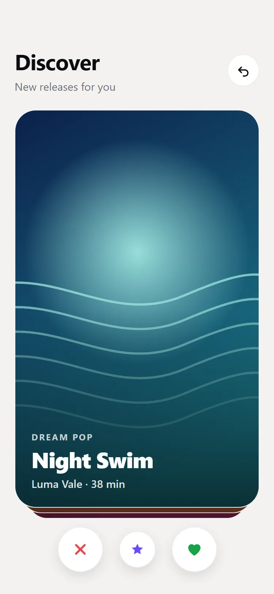
  </picture>
</a>

A card stack to swipe left, right or up. The card follows your finger and tilts, a stamp in your color says what
letting go will do, the next card rises underneath, buttons swipe for you and the last card comes back with undo.

```bash
npx expo install react-native-reanimated react-native-worklets react-native-gesture-handler expo-haptics
```

[Live preview](https://upfork.dev/products/swipe-deck-react-native) · [Source, demo app and docs](swipe-deck)

### Goal Ring

<a href="https://upfork.dev/products/skia-progress-ring-react-native">
  <picture>
    <source media="(prefers-color-scheme: dark)" srcset=".github/previews/skia-progress-ring-react-native-dark.webp">
    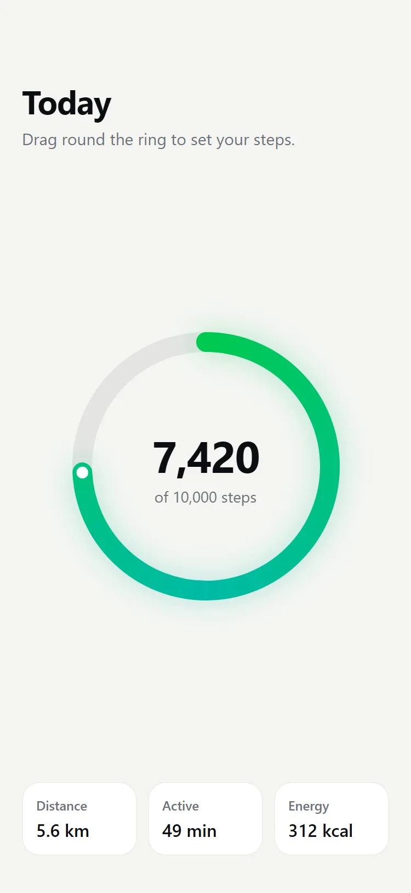
  </picture>
</a>

A progress ring drawn with Skia: a gradient arc with a soft glow, a dot riding its end and your content in the
middle. Animate it, drive it with a shared value, or let people drag round it to set a goal.

```bash
npx expo install @shopify/react-native-skia react-native-reanimated react-native-worklets react-native-gesture-handler expo-haptics
```

[Live preview](https://upfork.dev/products/skia-progress-ring-react-native) · [Source, demo app and docs](goal-ring)

### Slide to Confirm

<a href="https://upfork.dev/products/slide-to-confirm-react-native">
  <picture>
    <source media="(prefers-color-scheme: dark)" srcset=".github/previews/slide-to-confirm-react-native-dark.webp">
    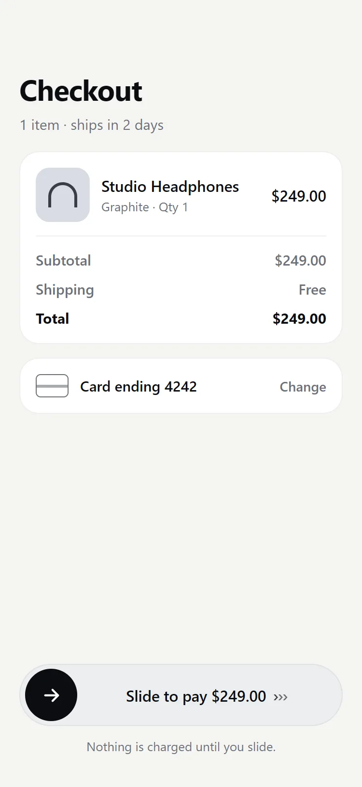
  </picture>
</a>

A slide-to-confirm button for payments, transfers and unlocks: drag to the end, see a spinner while your action
runs, then a done state, or an error you can retry. Haptics on phones, any tint.

```bash
npx expo install react-native-reanimated react-native-worklets react-native-gesture-handler react-native-svg expo-haptics
```

[Live preview](https://upfork.dev/products/slide-to-confirm-react-native) · [Source, demo app and docs](slide-to-confirm)

### Focus Scroll

<a href="https://upfork.dev/products/focus-scroll-react-native">
  <picture>
    <source media="(prefers-color-scheme: dark)" srcset=".github/previews/focus-scroll-react-native-dark.webp">
    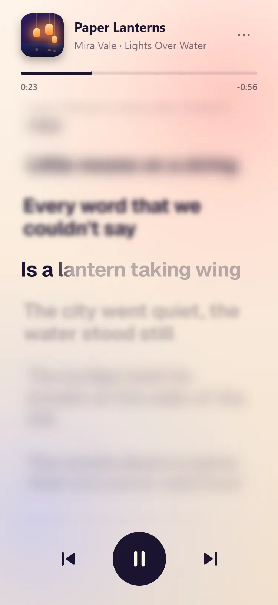
  </picture>
</a>

A scrolling list where only the item on the focal line is sharp: the rest blur, shrink, dim and lean away
like a camera's depth of field. Karaoke lyrics with a sweeping fill, stories, timelines, all on one Skia canvas,
with real blur on phones and on the web.

```bash
npx expo install @shopify/react-native-skia react-native-reanimated react-native-worklets react-native-gesture-handler expo-haptics
```

[Live preview](https://upfork.dev/products/focus-scroll-react-native) · [Source, demo app and docs](focus-scroll)

### Gooey Tab Bar

<a href="https://upfork.dev/products/gooey-tab-bar-react-native">
  <picture>
    <source media="(prefers-color-scheme: dark)" srcset=".github/previews/gooey-tab-bar-react-native-dark.webp">
    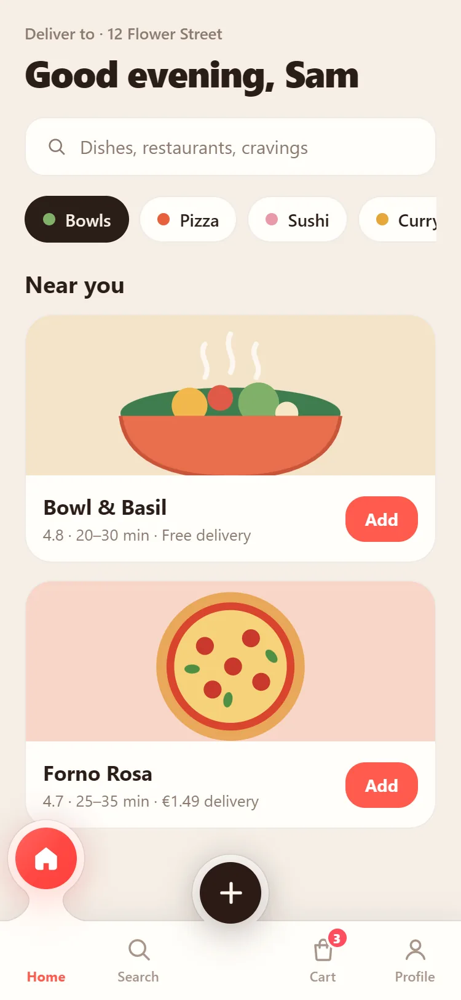
  </picture>
</a>

A bottom tab bar whose focused tab rides in a liquid bubble: it pinches off its neck, flies over and a new
neck grows to catch it where it lands. A notched cradle style, a centre button that blooms quick actions, and
badges that pop. Crisp Skia geometry with real shadows.

```bash
npx expo install @shopify/react-native-skia react-native-reanimated react-native-worklets react-native-safe-area-context react-native-svg expo-haptics
```

[Live preview](https://upfork.dev/products/gooey-tab-bar-react-native) · [Source, demo app and docs](gooey-tab-bar)

### Lustre Cards

<a href="https://upfork.dev/products/lustre-cards-react-native">
  <picture>
    <source media="(prefers-color-scheme: dark)" srcset=".github/previews/lustre-cards-react-native-dark.webp">
    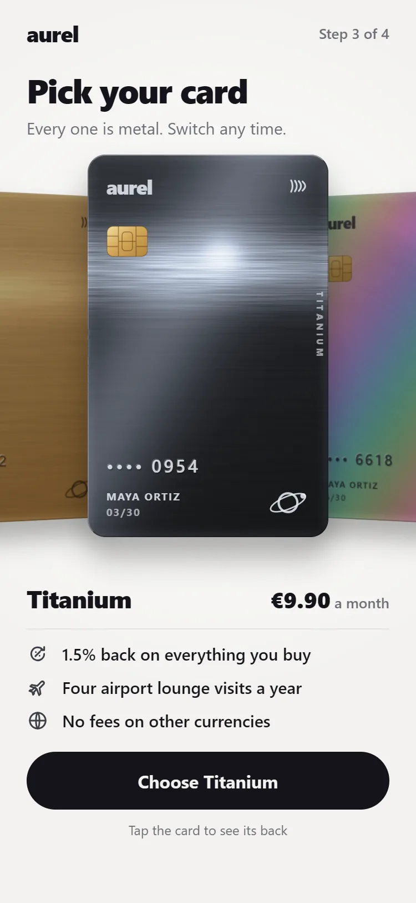
  </picture>
</a>

Payment cards in live metal (brushed steel, champagne gold, titanium, rose, a prism film and frosted glass)
whose reflections slide as they turn, tilt and flip. A depth carousel, the card's back with a hold-to-reveal code,
and a frost that freezes it. A Skia shader.

```bash
npx expo install @shopify/react-native-skia react-native-reanimated react-native-worklets react-native-gesture-handler react-native-svg expo-haptics
```

[Live preview](https://upfork.dev/products/lustre-cards-react-native) · [Source, demo app and docs](lustre-cards)

### Choice Chips

<a href="https://upfork.dev/products/choice-chips-react-native">
  <picture>
    <source media="(prefers-color-scheme: dark)" srcset=".github/previews/choice-chips-react-native-dark.webp">
    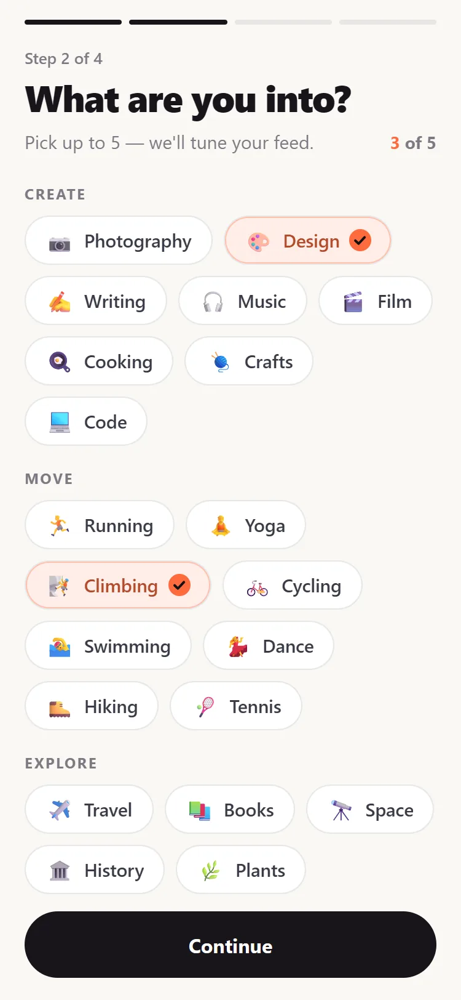
  </picture>
</a>

Choice chips that fill with colour from where you pressed, draw their check and reflow like sliding objects.
Multiple or single choice, limits with a polite refusal, wrap, scroll and grid layouts, keyboard and screen
readers.

```bash
npx expo install react-native-reanimated react-native-worklets react-native-svg expo-haptics
```

[Live preview](https://upfork.dev/products/choice-chips-react-native) · [Source, demo app and docs](choice-chips)

### Arc Picker

<a href="https://upfork.dev/products/arc-picker-react-native">
  <picture>
    <source media="(prefers-color-scheme: dark)" srcset=".github/previews/arc-picker-react-native-dark.webp">
    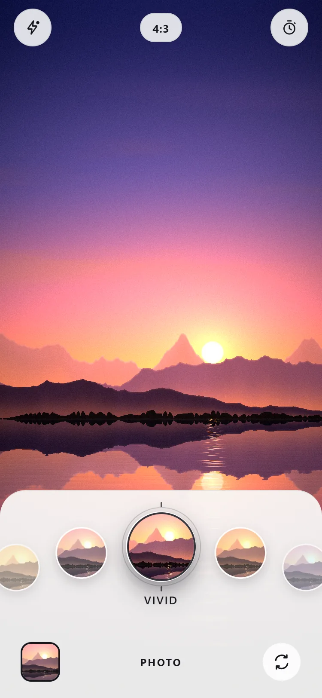
  </picture>
</a>

A curved dial carousel: items ride a true circular arc and the one under the ring is chosen. Momentum,
detents and an exact landing, with a live fractional index: the camera demo blends its viewfinder between two
filters as you turn, and the ring is its shutter.

```bash
npx expo install react-native-reanimated react-native-worklets react-native-gesture-handler expo-haptics
```

[Live preview](https://upfork.dev/products/arc-picker-react-native) · [Source, demo app and docs](arc-picker)

### Toast Stack

<a href="https://upfork.dev/products/toast-stack-react-native">
  <picture>
    <source media="(prefers-color-scheme: dark)" srcset=".github/previews/toast-stack-react-native-dark.webp">
    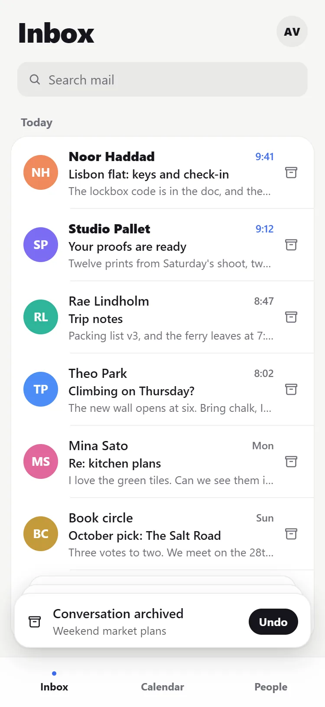
  </picture>
</a>

A complete toast system: `toast.success('Saved')` from anywhere, a collapsed stack that fans open, promise
toasts whose spinner turns into a check, Undo actions, upload progress, swipe to dismiss and timers that pause
while you read.

```bash
npx expo install react-native-reanimated react-native-worklets react-native-gesture-handler react-native-svg react-native-safe-area-context expo-haptics
```

[Live preview](https://upfork.dev/products/toast-stack-react-native) · [Source, demo app and docs](toast-stack)

### Clockface

<a href="https://upfork.dev/products/clockface-time-picker-react-native">
  <picture>
    <source media="(prefers-color-scheme: dark)" srcset=".github/previews/clockface-time-picker-react-native-dark.webp">
    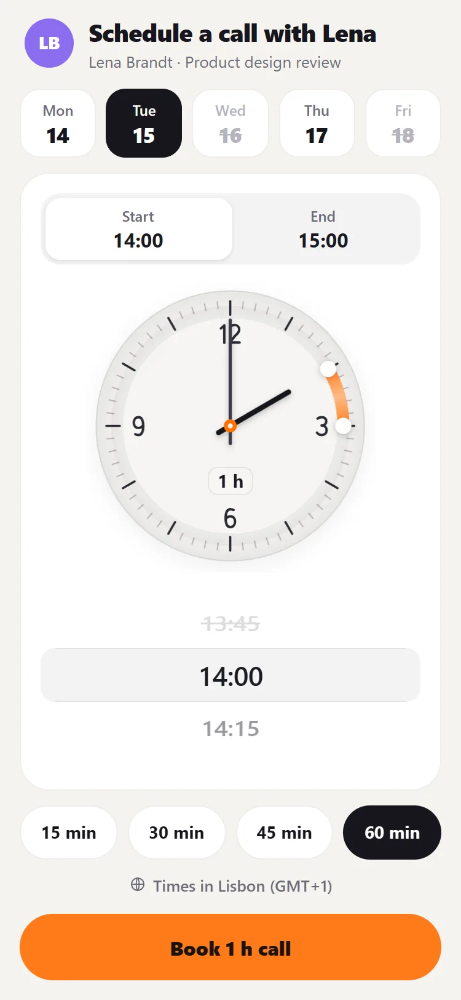
  </picture>
</a>

A time picker where a wheel of times and a live analog clock move as one: wind the wheel and the hands
sweep. Single times or ranges with the booked arc on the face, unavailable times skipped, and a minute hand you
can drag.

```bash
npx expo install @shopify/react-native-skia react-native-reanimated react-native-worklets react-native-gesture-handler expo-haptics
```

[Live preview](https://upfork.dev/products/clockface-time-picker-react-native) · [Source, demo app and docs](clockface-time-picker)

### Ambient Carousel

<a href="https://upfork.dev/products/ambient-carousel-react-native">
  <picture>
    <source media="(prefers-color-scheme: dark)" srcset=".github/previews/ambient-carousel-react-native-dark.webp">
    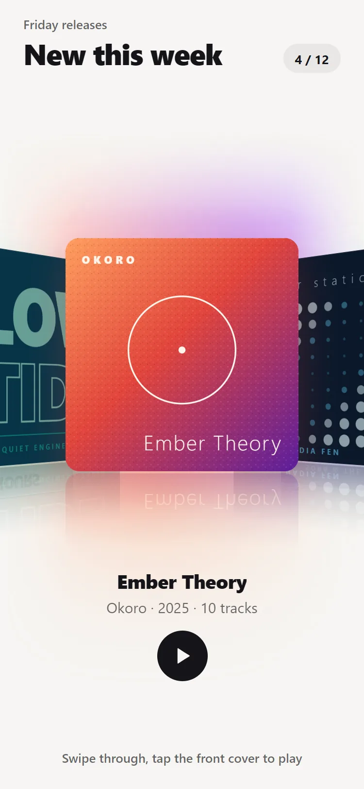
  </picture>
</a>

A cover-flow carousel: the cover in front faces you, its neighbours fold away in depth, and the stage glows in
its colours, a drifting aura that melts from palette to palette in OKLab as you swipe.

```bash
npx expo install @shopify/react-native-skia react-native-reanimated react-native-worklets react-native-gesture-handler expo-haptics
```

[Live preview](https://upfork.dev/products/ambient-carousel-react-native) · [Source, demo app and docs](ambient-carousel)

### Morph Text

<a href="https://upfork.dev/products/morph-text-react-native">
  <picture>
    <source media="(prefers-color-scheme: dark)" srcset=".github/previews/morph-text-react-native-dark.webp">
    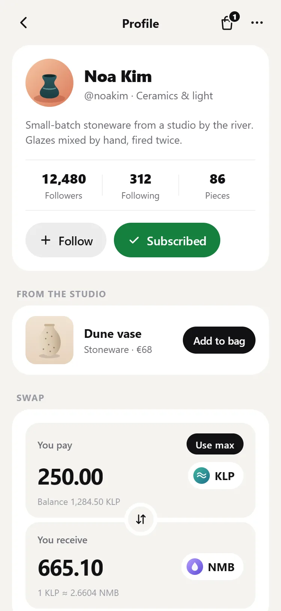
  </picture>
</a>

Text that changes in place instead of blinking: when a label changes, the letters both strings share glide to
their new places, removed ones leave and new ones rise in, never drawn over each other. Odometer numbers formatted
by `Intl`, a button that morphs through loading, success and error, and Persian and Arabic that stay joined.

```bash
npx expo install react-native-reanimated react-native-worklets react-native-svg expo-haptics
```

[Live preview](https://upfork.dev/products/morph-text-react-native) · [Source, demo app and docs](morph-text)

### Filmstrip

<a href="https://upfork.dev/products/filmstrip-react-native">
  <picture>
    <source media="(prefers-color-scheme: dark)" srcset=".github/previews/filmstrip-react-native-dark.webp">
    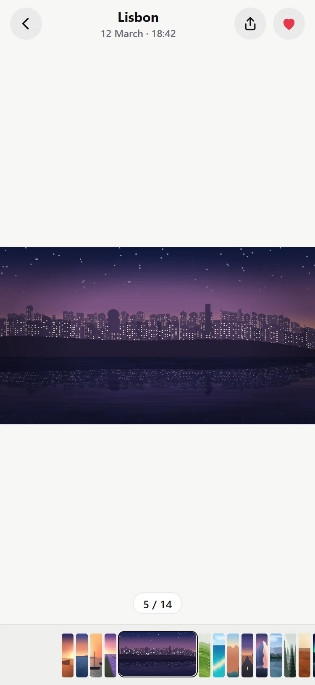
  </picture>
</a>

The gallery from a phone's photo app: a big viewer, and a strip where the current photo opens to its true shape
between slivers of the others. Scrub the strip and the viewer follows frame by frame; swipe the viewer and the
strip follows. No stretching, double-tap zoom, video chapters, and 500 items as smooth as 5.

```bash
npx expo install react-native-reanimated react-native-worklets react-native-gesture-handler react-native-svg expo-haptics
```

[Live preview](https://upfork.dev/products/filmstrip-react-native) · [Source, demo app and docs](filmstrip)

### Depth Drawer

<a href="https://upfork.dev/products/depth-drawer-react-native">
  <picture>
    <source media="(prefers-color-scheme: dark)" srcset=".github/previews/depth-drawer-react-native-dark.webp">
    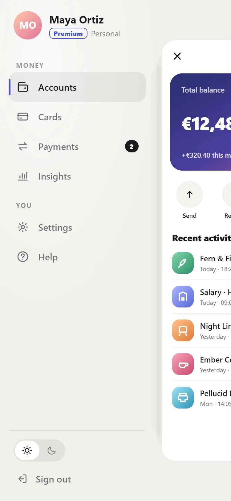
  </picture>
</a>

A side menu where the screen steps back into depth: it shrinks and moves aside with ghost layers behind it,
swings back like a door, slides, or stays under a floating menu card. One progress scrubs everything from the
first pixel of an edge swipe, the menu's entrance and a menu button whose bars turn into a close mark.

```bash
npx expo install react-native-reanimated react-native-worklets react-native-gesture-handler react-native-svg expo-haptics expo-status-bar react-native-safe-area-context
```

[Live preview](https://upfork.dev/products/depth-drawer-react-native) · [Source, demo app and docs](depth-drawer)

### Confirm Button

<a href="https://upfork.dev/products/confirm-button-react-native">
  <picture>
    <source media="(prefers-color-scheme: dark)" srcset=".github/previews/confirm-button-react-native-dark.webp">
    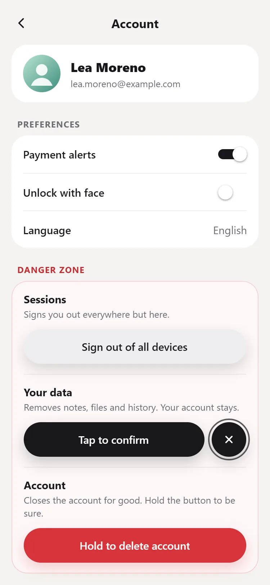
  </picture>
</a>

A button for actions that mustn't happen by accident: one press arms it and a cancel bubble buds off on a
liquid neck that stretches and snaps; a second press confirms through busy, done and error, driven by your
promise. It disarms itself with a countdown, or hold to confirm with a liquid fill. Skia, crisp edges.

```bash
npx expo install @shopify/react-native-skia react-native-reanimated react-native-worklets react-native-gesture-handler react-native-svg expo-haptics
```

[Live preview](https://upfork.dev/products/confirm-button-react-native) · [Source, demo app and docs](confirm-button)

## Running a demo

The React components come with a small Next.js demo:

```bash
cd crowdwall
pnpm install
pnpm dev
```

Then open the address in its README (for Crowdwall, <http://localhost:3000/demo/community-hero>). The HTML
sections need nothing: open `index.html` in a browser. `pnpm build` in their folder rebuilds it from `src/`.

The React Native components are Expo apps:

```bash
cd fluid-tab-bar
npm install
npx expo start
```

Press `w` for the browser, or scan the QR code with Expo Go. The bar at the top of the app switches between the
demos and the theme.

## More from UpFork

[upfork.dev](https://upfork.dev) has more: 3D and WebGL heroes, carousels, complete landing pages and
[React Native components](https://upfork.dev/mobile), each with a live preview. Most of them come with the Pro plan. AI assistants (Claude, Cursor, VS Code) can search UpFork and
install components through its [MCP server](https://upfork.dev/docs/mcp).

Found a bug in one of these? [Open an issue](../../issues).

## License

The code is [MIT](LICENSE). The demo photos are from Unsplash, under the Unsplash License (credited in each folder's
`PHOTOS.md` or README); the Geist font is under the SIL Open Font License; Lucide icons are under the ISC License. Replace the
demo photos with your own before you launch: the people pictured don't endorse your product. The React Native demos
have no photos: their covers, landscapes and icons are drawn in code, and the names in them are made up.
